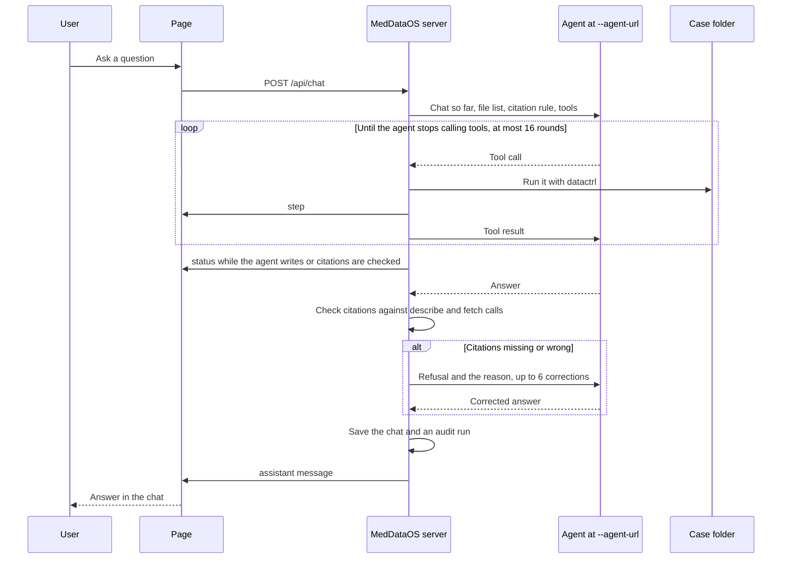

# MedDataOS

A local page for asking questions about the files in one folder. The server opens that folder with [datactrl](datactrl/README.md), serves the files, and sends each question to an OpenAI-compatible chat completions endpoint.

One process opens one folder. Chats, pins, review checkboxes, and audit runs are saved for that folder and come back when you reopen the same case. See [Case data](data.md).

## Start

Copy `.env.example` to `.env`, then from the repository root:

```bash
pixi run stack data/TCGA-DD-A4NF
```

That starts the example agent, the specialists in `configs/agents.toml`, and the server. Ctrl-C stops them. To start the pieces yourself, run `pixi run agent` and then:

```bash
pixi run serve /path/to/folder --agent-url http://127.0.0.1:8001/v1
```

Open the URL the server prints. `pixi run docs` serves this site, and `pixi run test` runs the server, datactrl, and specialist tests. The repository README is the GitHub landing page for the same quick start.

## What a question goes through



[Connect an agent](agents.md) is the request and citation contract. [Page](page.md) is what the browser shows. [Notes](specialists/notes.md) and [imaging](specialists/imaging.md) are optional specialists the router can call.

## Settings

Names match `.env.example`.

| Variable | Used for |
|---|---|
| `AGENT_MODEL`, `AGENT_API_KEY`, `AGENT_TIMEOUT` | What the server sends to `--agent-url`. Timeout default is 120 seconds. |
| `OPENAI_MODEL`, `OPENAI_BASE_URL`, `OPENAI_API_KEY` | The example agent. It ignores `AGENT_MODEL`. |
| `AZURE_OPENAI_API_KEY`, `AZURE_OPENAI_ENDPOINT`, `AZURE_OPENAI_DEPLOYMENT` | Azure, for the example agent and the specialists, when all three are set. |
| `AZURE_OPENAI_API_VERSION` | Azure API date, such as `2024-10-21`. |
| `AZURE_OPENAI_REASONING_EFFORT` | Set to `none` when a reasoning model refuses function tools. |
| `GEMINI_API_KEY` | Notes and imaging when Azure is not set. |
| `HOST`, `PORT` | Page bind address. Defaults are `127.0.0.1` and `8080`. |
